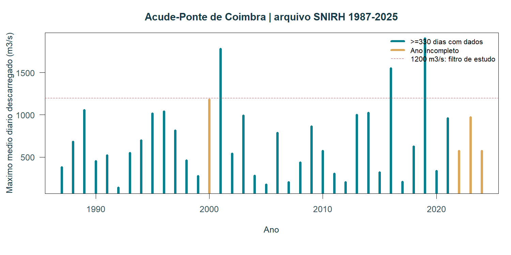
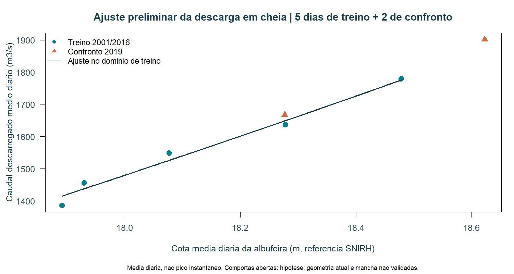
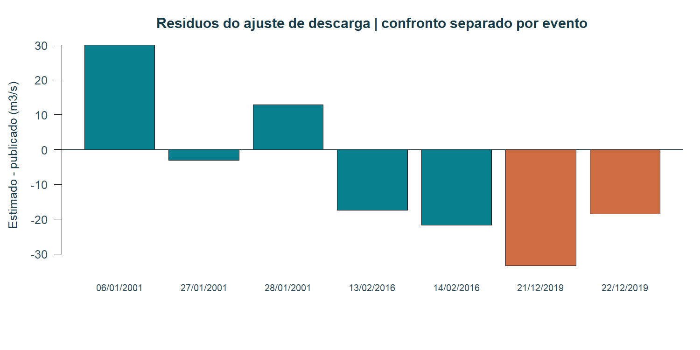
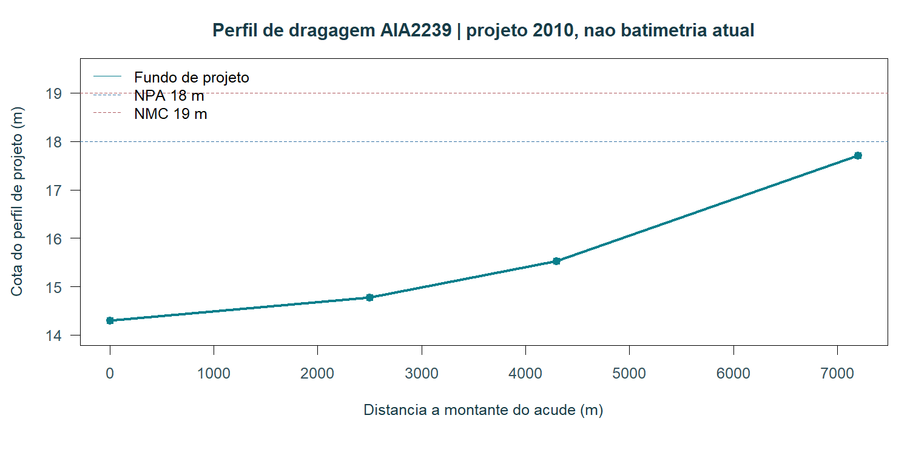

# IgnispyroFloods: integração de telemetria, arquivo hidrológico e controlo de qualidade para avaliação operacional do risco de inundação em Coimbra

Manuscrito preliminar · versão 0.2 · 24 de outubro de 2026. Resultados experimentais para revisão; sem validação operacional da mancha de inundação.

## Resumo
Apresenta-se um protótipo reproduzível que integra precipitação, observações hidrométricas, descargas de barragens, referências de geometria e exposição populacional. A investigação documental recuperou séries da estação Açude-Ponte de Coimbra, distinta da estação Ponte Santa Clara, com 13314 valores de caudal descarregado médio diário no período consultado de 1987–2025. A combinação com cotas de albufeira exigiu 24 amostras horárias distintas e sem sinalização para formar cada média diária. Foram identificados sete dias de cheia com caudal médio diário igual ou superior a 1200 m³/s. Cinco dias, pertencentes a três eventos de 2001 e 2016, suportaram um ajuste preliminar de um coeficiente de descarga. Dois dias de 2019 foram separados para confronto; um encontra-se fora do intervalo de treino. Os resultados permitem caracterizar uma componente agregada de descarga, mas não validar a resposta espacial atual do rio. O sistema conserva a proveniência, distingue grandezas diárias de instantâneas e bloqueia a sinalização operacional de freguesias enquanto faltarem geometria atual, referências verticais reconciliadas e validação independente da mancha. A análise, executada em R, é disponibilizada com dados, código e gráficos.

Palavras-chave: Mondego; Coimbra; descarga de barragens; SNIRH; calibração; R; inundação; população exposta.

## 1. Problema e objetivo
Uma observação de chuva ou um armazenamento elevado não determina a altura da água numa localidade. O encadeamento necessário compreende precipitação efetiva, escoamento, propagação fluvial, operação das estruturas, níveis e extensão espacial da inundação. A presença de açudes móveis acrescenta uma dificuldade: o mesmo nível pode coexistir com caudais muito diferentes, conforme a abertura das comportas e a condição de jusante. O objetivo desta fase é reunir evidência utilizável e testar componentes identificáveis antes de produzir classificações territoriais.

O contributo é uma implementação auditável para avaliação: distingue estação, parâmetro, resolução temporal, referencial vertical, domínio de ajuste e evidência em falta. Não se demonstra nesta fase melhoria de previsão nem capacidade operacional de alerta.

## 2. Fontes e área de estudo
O piloto abrange Coimbra e o sistema Aguieira–Raiva–Fronhas–açude, com influência do Ceira. A telemetria pública APA/InfoÁgua fornece séries com horas próprias por grandeza. O arquivo SNIRH do açude, código 12G/01AE, disponibiliza parâmetros diferentes dos de Santa Clara, código 12G/04H. Não se juntaram os dois locais como se fossem uma estação.

No arquivo do açude, os parâmetros 2279, 2284, 212296818 e 1629599726 representam, respetivamente, caudal afluente médio diário, caudal descarregado médio diário, caudal efluente médio diário e cota da albufeira. Foram recuperados 6507 valores diários de afluência, 13314 de caudal descarregado e 438 de efluência total. A distinção entre descarga e efluência foi conservada; ausência não foi substituída por zero nem por outra grandeza.

A ficha CNPGB identifica nove vãos de 15,4 m e soleira à cota 14,3 m, com NPA de 18 m e NMC de 19 m. São referências de projeto e não uma medição de abertura das comportas. O parecer AIA2239 de 2010 descreve três segmentos de perfil de dragagem: 2500 m a 0,019%, 1800 m a 0,042% e 2900 m a 0,075%, partindo da cota 14,3 m. Localizaram-se peças digitais DWF com referências a perfis de 1985 e cotas médias do levantamento de 2008 a jusante do açude. Estes elementos não constituem uma batimetria atual importada e verificada.

O artigo LNEC de Alves e Mendes documenta modelação hidráulica e a importância das condições de fronteira e estruturas. A documentação APA do segundo ciclo PGRI descreve uma solução bidimensional para Coimbra/estuário que inclui o açude e estruturas de inundação controlada. Estas referências sustentam a necessidade de modelar as estruturas; não transferem a sua calibração para este protótipo.

## 3. Preparação e controlo dos dados
Os valores da origem pública são lidos como dados, sem executar código remoto. Conservam-se URL, identificador, unidade, hora e hash dos ficheiros consultados. O fuso Europe/Lisbon é uma hipótese explícita onde o portal não inclui offset; horas ambíguas na mudança de hora são rejeitadas. A atualização da recolha não altera a data original da observação. Valores antigos permanecem identificados como antigos.

Para a análise histórica, a cota da albufeira não recebeu o zero de uma régua: trata-se de uma cota publicada, ao contrário da altura na régua de Santa Clara. Apenas dias com exatamente 24 amostras horárias distintas e sem sinalização geraram uma média de cota. Não se emparelhou a cota da meia-noite com o caudal médio do dia. Permanecem por confirmar de forma independente a convenção de agregação diária e eventuais particularidades dos dias de mudança de hora.

## 4. Ajuste preliminar em R
Adotou-se a relação Q = C × L × (Z − Zs)^(3/2), com L = 138,6 m e Zs = 14,3 m. Ajustou-se apenas C, por mínimos quadrados sem termo independente, usando lm em R. A expressão utiliza a média diária da superfície livre, não a carga de energia instantânea: o coeficiente é empírico e absorve parte destas simplificações. A seleção Q diário ≥1200 m³/s identifica um domínio de estudo de cheia; não prova que todas as comportas estavam livres nem estabelece um limiar oficial de alerta.

Os dias 06/01/2001, 27/01/2001, 28/01/2001, 13/02/2016 e 14/02/2016 foram usados no treino. Os dias 21/12/2019 e 22/12/2019 foram reservados para confronto temporal. Dias consecutivos do mesmo evento não foram repartidos entre treino e confronto. A avaliação separa pontos dentro e fora do intervalo de treino. Não se apresenta intervalo de confiança de 95%, atendendo ao reduzido número de eventos e à dependência temporal.

## 5. Resultados
O coeficiente obtido foi C = 1,499942 m^(1/2)/s. O RMSE de treino foi 19,26 m³/s. O confronto nos dois dias de 2019 produziu RMSE de 27,01 m³/s e viés de -25,95 m³/s. Este RMSE inclui um ponto fora do domínio de treino e é exclusivamente um diagnóstico de confronto. Dentro do domínio permaneceu apenas um ponto, com erro absoluto de 18,48 m³/s; um único ponto não demonstra capacidade de generalização.

O intervalo de cota do treino foi 17,8917–18,4783 m. A análise de exclusão de um evento de treino de cada vez produziu coeficientes entre 1,488854 e 1,506158. Esta amplitude é sensibilidade ao conjunto de eventos, não intervalo de confiança. Não foram calculados nem reivindicados erros de mancha, população atingida ou antecipação de alertas com base neste ajuste.

## 6. Integração das descargas e limites da mancha
As afluências, efluências e cotas observadas do açude alimentam agora um pacote de condições de fronteira e um diagnóstico de continuidade. A integração trapezoidal das taxas entre amostras simultâneas fornece volumes estimados; intervalos superiores a duas horas não são preenchidos. Não se presume conhecer armazenamento inicial, derivações, evaporação ou todos os contributos laterais.

Aguieira é interna à cascata que termina em Raiva e não é somada novamente. Raiva, Fronhas e Ceira são mantidos separados. Falta de medição de um contributo produz total desconhecido, não uma soma incompleta apresentada como caudal total. Mesmo com amostras simultâneas, faltam tempos de viagem, armazenamento no troço e afluências não medidas para usar essa soma como fronteira calibrada.

O cálculo de inundação exige ainda terreno e batimetria atuais no mesmo referencial vertical, representação de comportas e remanso, geometria e operação de diques e estruturas de descarga, propagação temporal e verificação de balanço. As peças DWF localizadas são informação histórica e de projeto; algumas conversões apresentaram truncagem ou omissões, pelo que não foram promovidas a geometria hidráulica completa. O perfil de dragagem de 2010 serve para análise de sensibilidade e planeamento de dados, não para afirmar onde a água está hoje.

Após uma mancha datada e validada, a interseção com CAOP e BGRI permite estimar residentes e grupos etários expostos. Ponderação uniforme por área de subsecção continua a ser estimativa; crianças e idosos não esgotam a vulnerabilidade, e população censitária não equivale a população presente em tempo real.

## 7. Protocolo de avaliação operacional
Propõe-se avaliação em paralelo, sem emissão de alertas, com registo de cada execução, estado dos dados e comparação com ocorrências observadas. A aceitação deverá exigir: transformação vertical documentada; geometria atual com data e controlo de qualidade; pares instantâneos Q/H e operação das estruturas; calibração por vários eventos com um conjunto independente reservado; métricas de nível, tempo de chegada, caudal e extensão espacial; quantificação de falsos positivos e omissões nas freguesias; revisão técnica responsável. Não se definiram limites de aprovação como se fossem normas oficiais.

O mapa público é uma versão para avaliação operacional. Na vista atual, dados em falta ou uma calibração parcial não produzem cores de inundação. O ajuste de descarga e os cenários de projeto estão identificados como experimentais. A expansão às bacias nacionais reutiliza contratos e verificações; não transfere coeficientes de Coimbra para outros rios.

## 8. Reprodutibilidade e conclusão
O código tools/coimbra-analysis.R executa com R de base, sem pacotes adicionais. O CSV diário, métricas, pares, perfil de projeto e sessionInfo são publicados com quatro figuras. A obtenção do histórico está em tools/coimbra-archive.cjs e a integração das fronteiras em tools/coimbra-boundaries.py. O conjunto permite auditar o avanço realizado: foi recuperado arquivo adicional e ajustada uma componente agregada de descarga. Não foi concluída a calibração hidráulica espacial nem autorizada a sinalização operacional de freguesias atingidas.

## Referências e dados
- weir_archive: https://snirh.apambiente.pt/snirh/_dadosbase/site/simplex.php?OBJINFO=INFO_ESTACOES&FILTRA_SITE=1627743374&FILTRA_COVER=920123705
- cnpgb: https://cnpgb.apambiente.pt/content/a%C3%A7ude-ponte-de-coimbra
- weir_section: https://cnpgb.apambiente.pt/sites/default/files/galerias/desenhos/Coimbra3des.gif
- aia2239: https://siaia.apambiente.pt/AIADOC/AIA2239/ParecerCA.pdf
- dwf_profiles: https://siaia.apambiente.pt/AIADOC/AIA2239/4175_10-anexo%203-desenhos201881152249.zip
- dwf_plans: https://siaia.apambiente.pt/AIADOC/AIA2239/anexo%201-figuras%20(1)201881153919.zip
- lnec2014: https://repositorio.lnec.pt/bitstream/123456789/1005939/1/Mondego_EA_LM.pdf
- official2001: https://snirh.apambiente.pt/snirh/download/relatorios/cheias_mondego_2001.pdf
- pgri: https://apambiente.pt/sites/default/files/_SNIAMB_Agua/DRH/PlaneamentoOrdenamento/PGRI/2022-2027/2_fase/Relatorio_1.pdf
- Formulação de descarga: https://www.hec.usace.army.mil/confluence/hmsdocs/hmstrm/reservoir-modeling/reservoir-modeling-concepts-and-equations/spillways
- R Core Team. R: A Language and Environment for Statistical Computing. https://www.r-project.org/

## Adenda: confronto espacial histórico de 2019

O produto independente Copernicus EMSR417 (Sentinel-1A, 23/12/2019 06:43 UTC) foi cruzado com reconstituições exploratórias do piloto. Após retirar água permanente e o canal assumido, o recorte observado mede 10,62 ha vetoriais (10,80 ha na grelha de 30 m). O cenário com o caudal médio diário do dia da imagem produz 2,16 ha no domínio comparável, sem interseção; o maior caudal médio diário do evento também não reproduz a área observada. A tolerância de 60 m não resolve a discrepância. O máximo do evento e a imagem não são simultâneos; as entradas diárias, as estruturas e a memória da planície não permitem uma validação operacional. A ausência de deteção SAR não prova terreno seco. Em 2001 e 2016, não há manchas independentes importadas com hora para atribuir métricas espaciais.

As interseções SAR nas freguesias e as estimativas BGRI2021 são exposição retrospectiva aproximada, não pessoas atingidas em 2019. O modelo permanece sem aceitação espacial. Métodos, gráficos, limites populacionais e dados em falta: https://dsantananet.github.io/ignispyro-floods/validation.html . Referência independente: https://mapping.emergency.copernicus.eu/activations/EMSR417/ALL/ .
