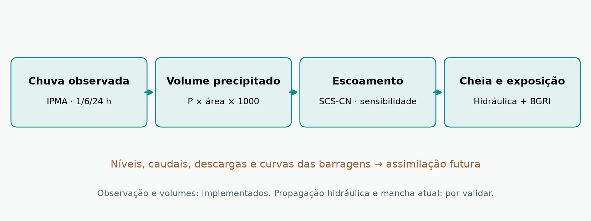
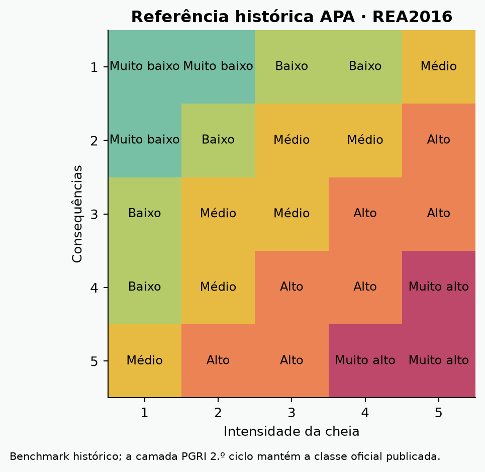

# IgnispyroFloods: integração de precipitação, escoamento, armazenamento e exposição populacional para apoiar a avaliação dinâmica de cheias em Portugal

**Manuscrito de método em desenvolvimento — 24 de outubro de 2026.** Autoria, afiliações, revista e coautores a definir. Este documento distingue resultados computacionais desta implementação de resultados científicos de validação, que ainda não existem.

## Resumo

Propõe-se uma plataforma reproduzível que integra observações meteorológicas, estimativas de precipitação em grelha, cartografia hidrográfica e de inundação e população censitária para investigar o potencial de cheia e a exposição humana em Portugal continental. O protótipo usa 227 estações IPMA, 262 unidades de bacia APA, 3 049 freguesias CAOP2025 e BGRI2021. Para apoiar a cobertura em áreas com poucas estações, foram obtidos 3 653 valores diários de precipitação ERA5 em cada uma de 28 referências regionais, entre 2016 e 2025. Os históricos são interpolados para as bacias por IDW3; as lacunas atuais são preenchidas com estimativas pontuais ECMWF IFS, identificadas separadamente das observações. A precipitação é convertida em volume e numa gama de escoamento pelo método SCS-CN, com parâmetros de sensibilidade ainda não calibrados. Um estudo preliminar estima Q10 de caudal médio diário em referências GloFAS; não equivale ao pico instantâneo nem delimita a área inundada. A vista operacional não sinaliza freguesias sem mancha hidráulica datada e demonstrada. Os resultados implementados mostram viabilidade de integração e cálculo, mas não demonstram desempenho preditivo ou utilidade operacional. O protocolo de validação inclui comparação por eventos e bacias, conservação de massa, caudal, nível, mancha e exposição de grupos vulneráveis.

**Palavras-chave:** cheias; precipitação acumulada; escoamento; população vulnerável; BGRI; CAOP; tempo de retorno; hidrologia operacional.

## 1. Problema e contributo a testar

A informação sobre chuva, rios, barragens e população encontra-se distribuída por fontes com cadências e resolução distintas. Uma classificação territorial de planeamento não descreve necessariamente a inundação num instante. De igual modo, chuva intensa não determina diretamente a altura da água num aglomerado. O contributo proposto é uma cadeia rastreável de transformação de dados, com separação entre observação, estimativa meteorológica, simulação hidrológica, simulação hidráulica e exposição populacional.

A novidade científica não está estabelecida pela construção do portal. Deve ser avaliada mediante revisão sistemática e demonstração de melhoria face a modelos e produtos existentes. A investigação centra-se na utilidade incremental da precipitação acumulada, das condições de escoamento, da operação das barragens e da população presente, incluindo a incerteza de cada componente.

**Questões:**

1. A inclusão de escoamento e estado hidrológico melhora a antecipação de caudal/nível relativamente a limiares exclusivos de precipitação?
2. A inclusão de afluências, descargas e armazenamento das barragens melhora a representação de eventos regulados?
3. A desagregação BGRI e a população presente alteram a ordenação das freguesias por exposição e suscetibilidade?
4. Qual a degradação do desempenho nas bacias sem boa cobertura de estações e quando se utilizam estimativas de grelha?

## 2. Área, unidades e escalas

Portugal continental é o domínio inicial. A cartografia APA contém 262 unidades de bacia no nível selecionado e 3 031 troços de ordem elevada na camada de visualização. Estes números são contagens de elementos do conjunto descarregado, não uma afirmação de que representam todos os rios ou todas as bacias hidrologicamente independentes. Bacias sobrepostas ou aninhadas não podem ter os seus volumes somados indiscriminadamente. As contribuições de Espanha devem integrar a modelação transfronteiriça; o recorte português é insuficiente para Douro, Tejo, Guadiana e outras bacias partilhadas.

O tempo de cálculo da chuva é horário, sujeito à emissão e latência das fontes. Os boletins de armazenamento têm cadências mensal ou diária. As séries GloFAS aqui utilizadas são diárias; não suportam a reconstrução de picos subdiários de cheia rápida. A BGRI descreve residentes na data censitária de 2021.

## 3. Dados e proveniência

| Componente | Fonte usada | Temporalidade e limite |
|---|---|---|
| Chuva observada | API IPMA, catálogo e observações | Incrementos horários das últimas 24 h; −99 é ausência |
| Chuva atual estimada | ECMWF IFS 0,25° via Open-Meteo | Um ponto representativo por bacia; previsão/arquivo recente, não observação |
| Referência 2016–2025 | ERA5 0,25° via Open-Meteo | 28 pontos regionais × 3 653 dias; não chuva areal observada |
| Bacias e rios | Serviços REST APA | Cartografia; não mede nível/caudal atual |
| Cenários de inundação | APA, Diretiva 2007/60/CE, 2.º ciclo | T20/T100/T1000 disponíveis; T10 ausente no serviço consultado |
| Armazenamento | SNIRH mensal e ARBCAS diária | 66 registos nesta recolha; não há telemetria de descarga assimilada |
| Caudal para estudo Q10 | GloFAS, via Open-Meteo Flood API | Série modelada diária; correspondência da célula com o rio por validar |
| Freguesias | DGT CAOP2025; CAOP2021 para comparação | Versões administrativas explícitas |
| População e idades | BGRI2021, cópia pública ArcGIS atribuída ao INE | Agregação e validação de totais; rever condições de redistribuição da cópia |
| População presente | Meta/operadores, apenas estudo de viabilidade | Sem feed ou acordo de acesso nesta implementação |

Cada observação mantém data de validade, data de consulta, unidade, fonte e estado. Uma consulta bem-sucedida não torna atual uma observação antiga. A ausência de dados não é convertida em zero.

## 4. Métodos implementados

### 4.1 Chuva e estimativa espacial

Os incrementos horários IPMA são somados em janelas completas de 1, 6 e 24 horas. Uma janela incompleta fica ausente. Nas bacias com pelo menos duas estações interiores sincronizadas, usa-se uma média simples como primeira aproximação; a cobertura espacial não é considerada validada apenas por cumprir esse mínimo. Nas restantes, usa-se um ponto ECMWF representativo, marcado como estimativa de grelha. O ponto não substitui uma integral areal de radar/estações/grelha e não é corrigido pelo viés local nesta versão.

Para a referência histórica, selecionaram-se 28 pontos representativos por cobertura espacial progressiva entre pontos interiores das bacias. As séries ERA5 diárias de 2016–2025 foram verificadas quanto a 3 653 dias completos, sem valores negativos ou nulos. Para cada bacia, os três pontos de grelha mais próximos são ponderados por distância inversa ao quadrado, com distância mínima de 1 km. Pontos de grelha coincidentes podem reduzir a independência espacial; deve ser quantificado no estudo final. Esta reconstrução tem resolução regional e não resolve chuva convectiva local.

Calculam-se totais e máximos diários anuais, média anual, percentis diários 95/99 e estatísticas mensais. As séries e o código permanecem rastreáveis no repositório. Não se apresenta o maior dia de dez anos como um extremo de retorno de cem ou mil anos.

### 4.2 Volume precipitado e escoamento

Para precipitação P em mm e área A em km²:

`V_precipitado = P × A × 1000 m³`.

No método SCS-CN:

`S = 25400/CN − 254; Ia = 0,2S`.

`Q = 0 se P ≤ Ia; Q = (P − Ia)²/(P + 0,8S) se P > Ia`.

`V_escoado = Q × A × 1000 m³`.

CN55, CN75 e CN90 são cenários de sensibilidade, não estimativas calibradas para os solos de cada bacia, nem quantis de uma distribuição. O escoamento calculado é volume gerado, não caudal de ponta ou volume de armazenamento fluvial. A aplicação diária do modelo no histórico é designada **proxy de escoamento diário por evento**, pois não implementa recuperação contínua da humidade do solo. O estudo final deve comparar este método com um balanço de solo contínuo e parametrização por solo/ocupação, incluindo impermeabilização, áreas ardidas e humidade antecedente.

### 4.3 Barragens e propagação: requisito para a fase hidráulica

O balanço necessário é `dS/dt = I − O`, acrescido dos termos de precipitação direta, evaporação e outras perdas quando relevantes. Exige curvas cota-volume-área, descarregadores, regras de exploração, afluência e descarga observada/prevista. Um reservatório cheio não implica, isoladamente, cheia a jusante; pode atenuar ou modificar a onda conforme a operação.

A propagação na rede e a relação caudal-nível requerem secções, rugosidade, declive, estruturas e condições de fronteira. Devem ser implementadas e validadas por bacia, usando HEC-HMS/HEC-RAS, LISFLOOD ou solução equivalente adequadamente configurada. Não se aumenta a largura cartográfica de um rio como substituto de uma mancha hidráulica.

### 4.4 Estimativa preliminar de Q10

Para referências GloFAS, extraem-se máximos anuais do caudal médio diário de 2016–2025. No ajuste Gumbel por momentos:

`β = s × sqrt(6)/π; μ = média − γβ`.

`Q_T = μ − β ln[−ln(1 − 1/T)]`.

Para T=10, a probabilidade anual de excedência é 0,10 no modelo ajustado. Apresenta-se também um estimador empírico com posições de Weibull e 1 000 réplicas bootstrap com semente fixa. A amostra de dez máximos é curta; os intervalos não removem a incerteza estrutural ou a escolha incorreta da célula fluvial. O caudal médio diário extremo não equivale ao pico instantâneo. O T10 não define uma mancha de inundação sem a relação caudal-nível e a hidráulica local.

O resultado da referência Régua foi identificado como não representativo do rio pretendido e excluído da interpretação, mantendo-se o registo para auditoria. As restantes referências também necessitam de correspondência espacial e validação com hidrometria local antes de uso operacional.

### 4.5 População, exposição e suscetibilidade

A população residente da BGRI não é população presente em tempo real. CAOP2025 e BGRI2021 exigem harmonização. O protótipo compara geometrias de freguesia 2021/2025 e usa uma sobreposição IoU ≥99,5% como critério exploratório de compatibilidade: 2 726 freguesias cumprem-no; 323 ficam pendentes. Não é certificação administrativa. A extração final do indicador INE 0014584 para a geografia2025 falhou nesta rede; não se substituíram essas falhas por contagens inventadas.

Para um cenário e uma freguesia, consultam-se as subsecções BGRI, recortam-se os polígonos e calcula-se uma estimativa por fração de área: `E = Σ n_i × área(B_i ∩ F ∩ M)/área(B_i)`. A união da mancha M evita dupla contagem. A hipótese de população uniforme pode falhar fortemente; deve ser comparada com desagregação dasimétrica por edifícios residenciais. A precisão das geometrias de visualização não permite tratar a estimativa como contagem exata de pessoas.

São mostrados separadamente 0–14 anos e 65+ anos. A soma é uma medida etária de suscetibilidade, não toda a vulnerabilidade. Mobilidade reduzida, dependência, isolamento, acesso a transporte e equipamentos requerem dados próprios; não se inferem de redes sociais.

### 4.6 Regra de sinalização atual e matriz

A vista principal só deverá sinalizar uma freguesia quando uma **mancha hidráulica atual datada e validada** intersectar o seu território. O nível deve derivar da cadeia hidrológica/hidráulica, não do volume dividido pela área total da freguesia. Na ausência dessa etapa, o mapa comunica avaliação pendente e mantém a rede fluvial azul. Os cenários APA só aparecem numa consulta de planeamento separada.

A matriz histórica APA/REA2016 combina intensidade e consequências e serve de benchmark documental. A classe oficial PGRI do 2.º ciclo é preservada. Uma nova matriz deverá ser pré-especificada e avaliada contra impactos observados, separando probabilidade, intensidade física, exposição e suscetibilidade, em vez de somar indiscriminadamente escalas ordinais. A seleção dos limiares e pesos é uma hipótese de investigação, não um resultado.

## 5. Resultados computacionais desta versão

- Recolha IPMA de 227 estações, com conservação de horas e falhas; o número de estações recentes e completas varia a cada recolha.
- Referência de dez anos: 28 pontos × 3 653 dias = 102 284 valores diários ERA5 verificados; estatísticas estimadas para 262 bacias.
- No snapshot inicial, 19 bacias cumprem o critério de estações; 243 usam preenchimento meteorológico ECMWF. A simulação passa a ter estimativas para 262 bacias, sem as apresentar como observações.
- BGRI agregada: 10 343 066 residentes nacionais na geografia censitária, com grupos 0–14 e 65+; correspondência territorial parcial conforme indicado.
- 66 registos de boletins de armazenamento, sem assimilação de descarga.
- Cálculo preliminar de Q10 diário modelado em referências fluviais; uma referência espacial problemática foi sinalizada para exclusão/revisão.
- Testes de cálculo temporal, distinção nulo/zero, conservação de volumes, matriz e contrato de mobilidade.

Os valores atuais, máximos, percentis e Q10 são entregues nos ficheiros de dados e no relatório. **Não existem nesta versão resultados de validação de previsão de cheias, mapas atuais de profundidade/velocidade ou estimativas validadas de pessoas efetivamente afetadas.**

## 6. Desenho de validação

Comparar M0 (chuva), M1 (chuva+solo+escoamento), M2 (M1+propagação+barragens) e M3 (M2+exposição/presença). Separar desempenho hidrológico do desempenho de impacto. A validação deve usar eventos independentes, divisão cronológica e exclusão de bacias para avaliar transferência; não dividir aleatoriamente horas do mesmo evento entre treino e teste.

Critérios: balanço de massa, viés de volume, KGE/NSE com limitações explicitadas, erro e antecedência do pico, erro de nível, CSI/IoU da mancha, precisão/recall por freguesia, calibração probabilística e métricas de falsas omissões/alertas. Para população, avaliar contra edifícios e contagens independentes agregadas; quantificar intervalos de incerteza, sem publicar dados individuais. Fazer ablação das barragens e do preenchimento meteorológico.

O inventário de eventos, a dimensão amostral e os limiares operacionais devem ser definidos antes do teste final. Não escolher métricas/limiares exclusivamente para melhorar a apresentação de resultados. Só após validação histórica e ensaio prospetivo se poderá propor utilização operacional.

## 7. Limitações e trabalho necessário

Resolução regional da precipitação; cobertura desigual de estações; chuva convectiva; CN não calibrado; ausência de rede transfronteiriça; ausência de descargas; caudal diário vs pico; correspondência espacial GloFAS; incerteza dos extremos com dez anos; simplificação de geometria; alteração de freguesias; população uniforme; ausência de população presente e de outras dimensões de vulnerabilidade. Nenhum destes limites é resolvido apenas pela atualização frequente da página.

## Referências primárias e documentação

1. IPMA. API de observação meteorológica. https://api.ipma.pt/
2. APA. SNIRH. https://apambiente.pt/agua/sistema-nacional-de-informacao-de-recursos-hidricos-snirh
3. APA. Cartografia Diretiva200760CE_2c. https://sniambgeoogc.apambiente.pt/getogc/rest/services/SNIAmb/Diretiva200760CE_2c/MapServer
4. DGT. OGC API. https://ogcapi.dgterritorio.gov.pt/
5. INE. Indicador 0014584. https://www.ine.pt/xurl/indx/0014584/PT
6. USACE. HEC-HMS, métodos de perdas. https://www.hec.usace.army.mil/confluence/hmsdocs/hmsum/4.14/subbasin-elements/selecting-a-loss-method
7. USACE. Reservoir modeling concepts and equations. https://www.hec.usace.army.mil/confluence/hmsdocs/hmstrm/reservoir-modeling/reservoir-modeling-concepts-and-equations
8. Open-Meteo. Historical Weather API. https://open-meteo.com/en/docs/historical-weather-api
9. Open-Meteo. ECMWF API. https://open-meteo.com/en/docs/ecmwf-api
10. Open-Meteo. Flood API. https://open-meteo.com/en/docs/flood-api
11. Copernicus. GloFAS historical discharge. DOI:10.24381/cds.a4fdd6b9. https://ewds.climate.copernicus.eu/datasets/cems-glofas-historical
12. Meta. Population During Crisis. https://ai.meta.com/ai-for-good/datasets/facebook-population-maps/
13. ARBCAS. Situação de armazenamento. https://pagina.arbcas.pt/

Antes de submissão: completar revisão bibliográfica académica, dados hidrométricos, protocolo registado, validação e declarações de dados/licenças/conflitos de interesse. Não submeter este rascunho como estudo validado.

## Atualização 24/10/2026 — piloto hidráulico executável
O piloto de Coimbra já calcula caudal propagado, nível em secções derivadas do DSM, mancha ligada ao rio limitada pelo volume disponível e exposição BGRI. Ver [método, resultados e limites](PILOTO_HIDRAULICO_COIMBRA.md). É uma estimativa experimental, sem calibração, separada da publicação de risco operacional validado. Os parágrafos anteriores sobre hidráulica pendente referem-se à validação e expansão nacional, não à ausência deste piloto.

